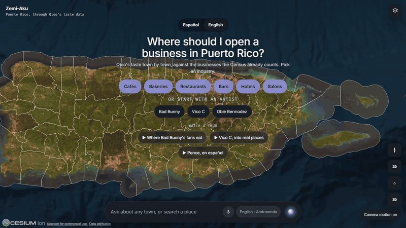
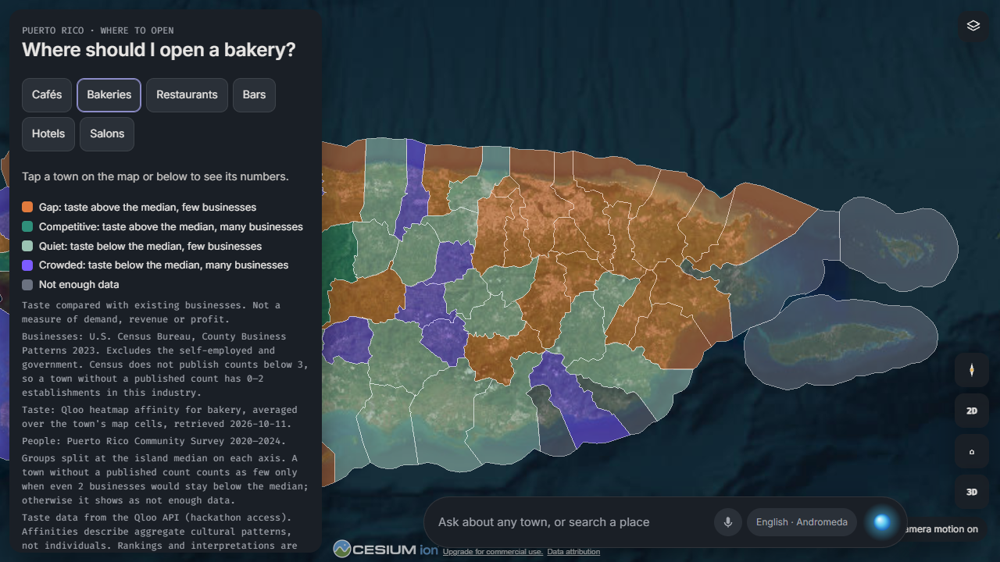
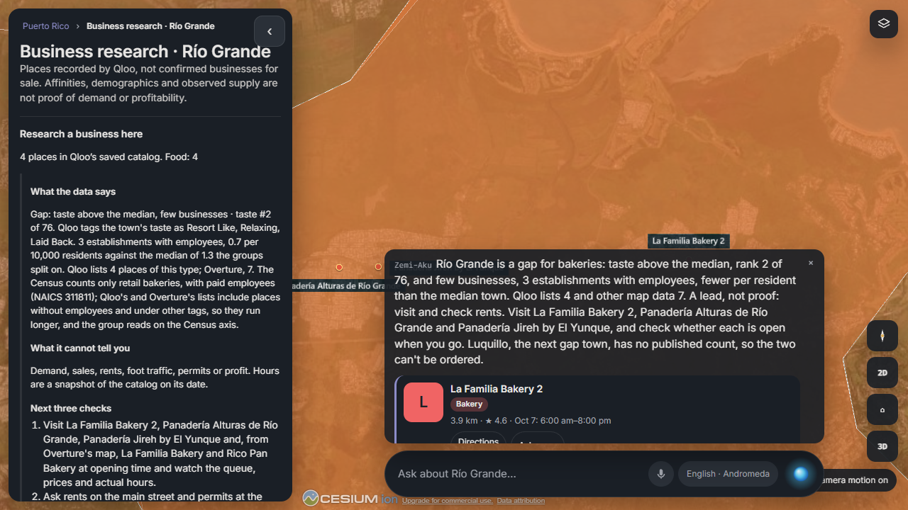
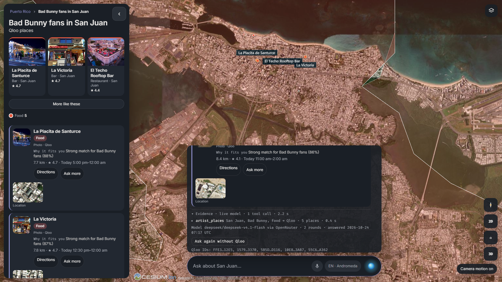
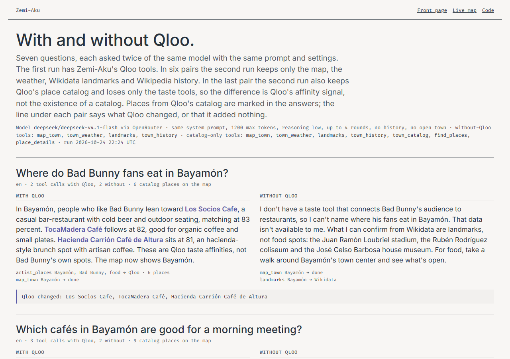
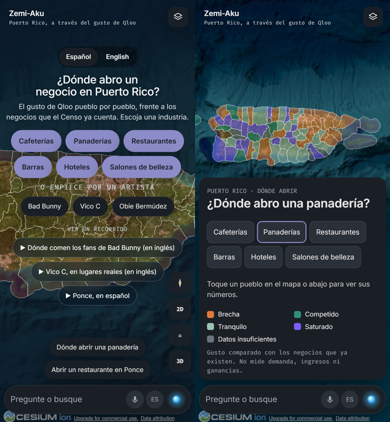
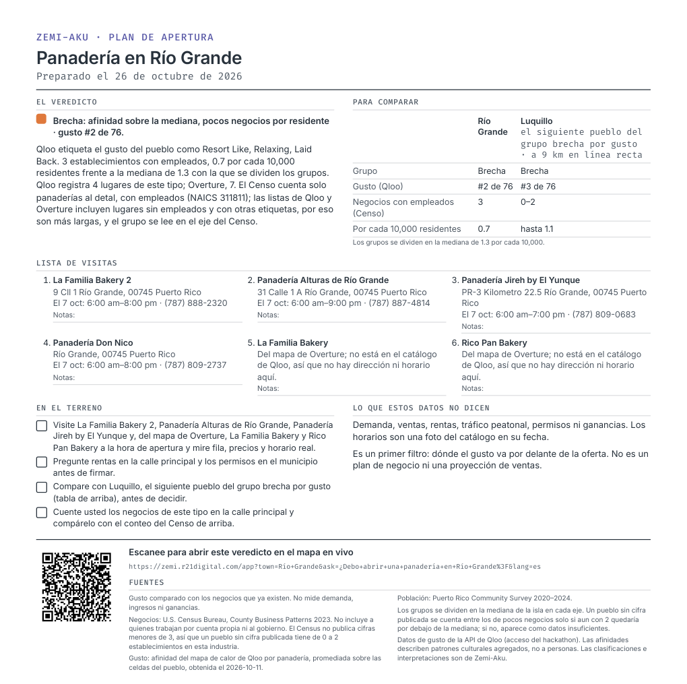
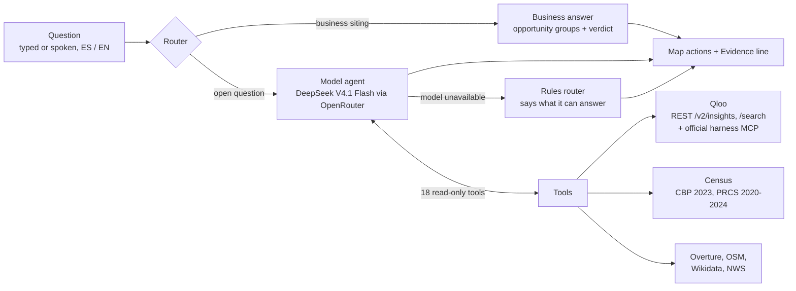

<p align="center">
  <picture>
    <source media="(prefers-color-scheme: dark)" srcset="docs/media/lockup-dark.svg">
    
  </picture>
</p>

<h3 align="center">Where should I open a business in Puerto Rico?</h3>

<p align="center">
  Qloo's taste data, town by town, against the businesses the Census already counts.<br>
  Ask in Spanish or English; a model agent answers from 18 read-only tools and shows its evidence.
</p>

<p align="center">
  <a href="https://zemi.r21digital.com/app"></a>
  <a href="https://zemi.r21digital.com/compare"></a>
  
  <a href="LICENSE"></a>
  
</p>

<p align="center">
  
</p>

Zemi-Aku is a map of Puerto Rico's 78 municipalities for people deciding where to open a café, bakery,
restaurant, bar, hotel or salon. For each town it sets Qloo's taste affinity for that kind of place against the U.S.
Census count of businesses with employees, and calls a town a **gap** when the taste is above the island median
and the businesses are few. It names real places from Qloo's catalog, says what the data cannot tell you (demand,
rent, permits, profit) and gives the next three checks to make on the ground. You can also start from an artist:
"Where do Bad Bunny fans eat in San Juan?" turns a music taste into real place records, a 3D map and a conversation.

An affinity is not evidence of an artist visit or a forecast of business demand, and the app says so where it matters.

## Judge it in 60 seconds

1. Open **[/app](https://zemi.r21digital.com/app)** and choose **Bakeries**. The island colours into four groups:
   gap, competitive, quiet and crowded.
2. Tap **Río Grande**. The verdict gives its taste rank, the Census count against the median, Qloo's list of places,
   what the data cannot tell you and the next three checks. **Opening plan to print** under the verdict turns it into
   one page to carry on the visit ([example](https://zemi.r21digital.com/plan?industry=bakery&town=R%C3%ADo%20Grande&lang=es)).
3. Ask **"Where do Bad Bunny fans eat in San Juan?"** and open **Evidence** under the answer: every tool call,
   source, count, timing and the engine that answered. **Ask again without Qloo** reruns it with the Qloo tools removed.
4. Open **[/compare](https://zemi.r21digital.com/compare)**: seven frozen questions asked of the same model twice,
   once without Qloo, with a line under each pair saying what Qloo changed, or that it added nothing.

Switch to **Español** on the first screen (or open [/app?lang=es](https://zemi.r21digital.com/app?lang=es)) and the whole
session, including answers and errors, stays in Spanish.

## What you will see

| | |
|---|---|
|  |  |
| **Opportunity map.** Qloo heatmap taste per town against Census County Business Patterns 2023, split at the island median. | **A town verdict.** Rank, count against the median, Qloo and Overture lists, what it cannot tell you, three field checks. |
|  |  |
| **An answer with its evidence.** Tool calls, Qloo IDs, model, rounds and timing; one button reruns it without Qloo. | **The control.** The same model and prompt with and without the Qloo tools, side by side. |

<p align="center"><br>
<sub>A phone, in Spanish.</sub></p>

<p align="center"><br>
<sub>The opening plan, printed: the verdict, the town the verdict compares with, places to visit with their hours, a field
checklist, the limits and a QR code back to the live map, on one Letter page.</sub></p>

## How it works



- **Only validated tool results move the map.** The model cannot invent a place or a map action: a place must come
  from a tool result with a Qloo ID, and every answer carries a folded Evidence line.
- **Town-level advice only.** A sentence that sites a business inside a town or asserts foot traffic is removed from
  model answers; the app has no data for either.
- **Island questions stay island-wide.** "Which town…", "¿En qué pueblo…?" and "besides San Juan" are never answered for
  the town on screen.
- **When the model is unavailable** (budget, cap or provider error) a rules router answers the questions it can and
  says plainly what it cannot; the Evidence line names the engine and the reason.

## Where Qloo is used

| What the app asks | Qloo call | Used by |
|---|---|---|
| Which towns lean toward a kind of place | `GET /v2/insights` `filter.type=urn:heatmap`, `filter.location.query=Puerto Rico`, `signal.interests.tags=<genre tag>` | Opportunity map (`scripts/opportunity.mjs`), `opportunity_map` |
| Which towns lean toward an artist's fans | `GET /v2/insights` `filter.type=urn:heatmap`, `signal.interests.entities=<artist id>` | `artist_towns` |
| Places an artist's fans like in a town | `GET /search` (artist) → `GET /v2/insights` `filter.type=urn:entity:place`, `signal.interests.entities`, `filter.location.query` | `artist_places`, "More like these" |
| Every place Qloo knows in a town | `GET /v2/insights` `filter.type=urn:entity:place`, `filter.location.query=<town>, Puerto Rico`, every page | `town_catalog`, `find_places`, `place_details` |
| Places for a taste ("mofongo", "rooftop") | harness `qloo_find_tags` → `GET /v2/insights` with `filter.tags` or `signal.interests.tags` | `find_places` (taste mode) |
| A town's cultural profile | `GET /v2/insights` `signal.location.query` for artists, TV shows and place tags (`filter.parents.types=urn:entity:place`) | `town_profile` |
| What a place's fans also like | `GET /v2/insights` artists and destinations with `signal.interests.entities=<place id>` | `fans_also_love` |
| Who likes a place | harness `qloo_audience_demographics` | `place_audience` |
| Describe, recommend, compare, tag, trend | harness `qloo_describe`, `qloo_recommend`, `qloo_compare_audiences`, `qloo_entity_tags`, `qloo_trends` | the tools of the same names |

"Harness" calls go through Qloo's official MCP server from `@qloo/qloo-harness`, kept as one long-lived client
(`server/qloo-mcp.mjs`). Qloo responses are not stored in this public repository, as Qloo's
[hackathon guide](https://docs.qloo.com/reference/qloo-llm-hackathon-developer-guide) asks.

## How it was checked

- **525 automated tests** (`pnpm test`), plus browser acceptance checks run against the live site
  (`scripts/check-ui-states.mjs`, 27 checks; `scripts/check-answer-states.mjs`, 16; `scripts/check-demo.mjs --journeys`).
- **A preregistered backtest of the gap signal** on Census counts, 2019 to 2023
  ([BACKTEST-GAP-2026-10-26.md](docs/BACKTEST-GAP-2026-10-26.md)): towns the rule would have called a gap gained more
  establishments than equally sparse, lower-taste towns in 5 of 6 industries, p = 0.07 one-sided. Suggestive, not
  proven; bakeries are the one loss, and Qloo's taste was measured after the window.
- **The with-and-without-Qloo control** at [/compare](https://zemi.r21digital.com/compare): seven frozen questions, the
  seventh keeping Qloo's place catalog and removing only the taste tools.
- **Blind review rounds** by AI agents from three vendors working only from the public site, with every report kept:
  latest [JUDGE-PANEL-2026-10-26.md](docs/JUDGE-PANEL-2026-10-26.md). Each round's findings were fixed and
  re-reviewed before release ([deploy history](docs/DEPLOY.md)). This is automated review, not user research.
- **Known limits.** Qloo affinity is not demand; Census counts exclude the self-employed and are suppressed below three;
  catalog hours are a dated snapshot (October 7); the hosted MCP connector stays off; a real phone, a microphone turn
  and a screen reader have not been tested end to end.

## Run locally

Node 22.19+ and pnpm 10.14.0 are required by the Qloo harness and reproducible install.

```sh
npm install --global pnpm@10.14.0
pnpm install --frozen-lockfile --ignore-scripts
cp .env.example .env
# Add your own keys privately.
pnpm eagle
```

Open the printed URL and /app. QLOO_API_KEY enables taste discovery. OPENROUTER_API_KEY
enables the model agent; DEEPGRAM_API_KEY enables speech. CESIUM_ION_TOKEN is an optional,
restricted read-only browser token for terrain and 3D. CENSUS_API_KEY builds the optional
demographic cache. Other provider credentials stay server-side. Never commit .env.
Optional AISSTREAM_API_KEY stays server-side; ZEMI_AIS_ENABLED defaults to 0 until
regional coverage is verified.
Optional TESTFLIGHT_PUBLIC_URL is a public TestFlight link from App Store Connect
(`https://testflight.apple.com/join/...`); when unset, the front page shows the request form.

Use pnpm, not npm install: pnpm overrides patch vulnerable transitive versions pinned in
the harness's npm shrinkwrap. The committed pnpm lock and Dockerfile use the same install.

Or populate .env and run `docker compose up --build`; open http://localhost:8080/app.
A clean checkout builds with empty optional ground caches. Town catalogs populate at
runtime; the 7,717-place count is an October 7 snapshot, not guaranteed live coverage.
Saved Qloo results are not in the public repository: the /compare runs and the three instant samples.
With your own keys, `node scripts/compare-qloo.mjs` and `node scripts/save-samples.mjs` rebuild them against a
local server (see each script's header); without them /compare says the runs could not be loaded and the samples
are simply absent. Ground-cache generation and safe hosting are explained in [deployment](docs/DEPLOY.md).

## Verify

```sh
pnpm test
pnpm audit --prod
node scripts/check-demo.mjs http://127.0.0.1:4174
# Optional real Qloo checks, no paid model/audio requests:
node scripts/check-demo.mjs http://127.0.0.1:4174 --journeys
```

There are 525 local automated tests. A fresh clone of the public repository skips four: the one
that needs the Census cache and the three that read the saved Qloo results.
Public HTTPS, Chrome journey/3D, private-path protection and capped WebSocket probes pass.
Live speech and a real iPhone still require separate verification.

## Use it from Claude Code or Codex (local)

The MCP connector serves 13 of the app's 18 read-only tools (all but map_town, town_weather,
qloo_trends, place_audience and artist_towns), from your own machine with
your own Qloo key. It is off unless `ZEMI_MCP_ENABLED=1`; the public site keeps it off until
Qloo confirms in writing that a hosted endpoint is allowed.

```sh
# shell 1, project root, after `pnpm install` and a filled .env
ZEMI_MCP_ENABLED=1 ZEMI_PUBLIC_URL=http://127.0.0.1:4173 pnpm eagle
# shell 2: 13 tools, artist_places and town_profile answer, four refusal probes pass
node scripts/check-mcp.mjs http://127.0.0.1:4173 --probes
```

Then point a client at `http://127.0.0.1:4173/mcp` (streamable HTTP, no sign-in):

- **Claude Code:** `claude mcp add --transport http zemi-aku http://127.0.0.1:4173/mcp`, then ask
  "Where do Bad Bunny fans go in Ponce?" and the answer links back to the map.
- **Codex CLI:** in `~/.codex/config.toml`, add `[mcp_servers.zemi-aku]` with
  `url = "http://127.0.0.1:4173/mcp"`.

Each tool result includes a `map_url` that opens the matching view in the browser. The
connector never calls a model or a speech provider; its Qloo use counts against your own key.

## Structure

| Path | Responsibility |
|---|---|
| app/index.html, app/dossier.js | Island → town → place, artist journey and source cards |
| app/home.html | Field-atlas landing page |
| app/opportunity.js, server/opportunity.mjs | Opportunity map: taste against businesses, four groups |
| app/plan.html, app/plan.js, server/plan.mjs | Printable opening plan for one town and industry |
| app/decision.js | The verdict's sentences, shared by the map's card and the plan |
| app/vendor/qrcode.js | qrcode-generator 2.0.4 (MIT, Kazuhiko Arase), unmodified |
| server/discovery.mjs, server/catalog.mjs | Validated artist entry and municipality catalogs |
| app/coastal.js, server/coastal.mjs, server/ships.mjs | Port discovery and optional bounded AIS feed |
| server/agent.mjs, server/agent-tools.mjs | Conversation and 18 read-only tools |
| server/business.mjs | Saved business context, demographic/taste research and listed-peer proximity |
| server/qloo-mcp.mjs | One long-lived client to Qloo's official harness MCP server |
| scripts/serve-eagle.mjs | Single-origin HTTP/WebSocket server, provider boundary and rules router |
| server/limits.mjs, server/agent.mjs | Visitor limits and persisted model reservations |
| server/voices.mjs, app/converse.js | Deepgram speech integration and browser conversation |
| cache/ | Private runtime catalogs, optional ground data, budgets and signup storage |
| Dockerfile, deploy/ | Pinned container, isolated Ubuntu bootstrap, Caddy/Compose |

Keep exactly one application process: spend and outbox files are not a distributed
database. Pages, APIs and voice callbacks share one HTTPS origin. The live demo runs on an isolated
Always Free Oracle VM with HTTPS; the model agent runs under a daily budget and forty model turns per visitor,
and Deepgram Aura-2 voices run under their own daily cap.

## Project notes

- [Deploy history and release checks](docs/DEPLOY.md)
- [Judge walkthrough](docs/JUDGE-WALKTHROUGH.md) and the [judge dry run](docs/JUDGE-DRYRUN-2026-10-14.md)
- Releases: [model agent](docs/PUBLIC-AGENT-2026-10-11.md), [voices](docs/PUBLIC-VOICES-2026-10-11.md),
  [business research](docs/PUBLIC-BUSINESS-2026-10-08.md), [coastal](docs/PUBLIC-COASTAL-2026-10-08.md),
  [first public demo](docs/PUBLIC-DEMO-2026-10-08.md)
- Second-model reviews: [round 1](docs/CODEX-REVIEW-2026-10-14.md), [round 2](docs/CODEX-REVIEW-2026-10-17.md)
- [Submission draft](docs/SUBMISSION-DRAFT.md) and [video script](docs/VIDEO-SCRIPT.md)
- [Original spec](docs/SPEC.md), [conversation agent](docs/SPEC-2026-10-07-conversation-agent.md)
- [Voice verification](docs/VOICE-AGENT.md), [Qloo toolkit findings](docs/2026-10-07-qloo-kit-findings.md)
- [Official rules](https://qloo.devpost.com/rules). Deadline October 30, 11:45 PM EDT.

## License

MIT for this project's code. See LICENSE. Third-party software, imagery and source data
retain their own licenses and attribution requirements.
